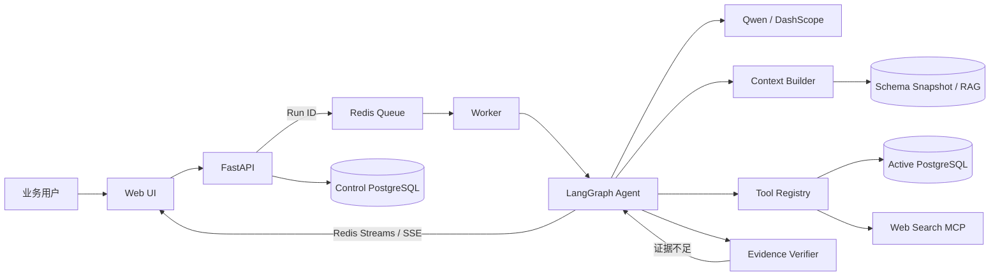

# InsightForge Agent

基于 LangGraph 的企业数据智能分析平台。用户可以连接只读 PostgreSQL 数据源，用自然语言提出经营问题；系统自动读取 Schema、规划查询、执行安全 SQL、核验数据证据，并返回结论、指标卡、明细表和图表。

> 当前版本：`v0.2.0`
>
> 本地地址：<http://127.0.0.1:6006>
> 定位：学习、作品展示与 Agent 工程实践，不建议未经安全加固直接部署到公网。

## 核心能力

- **动态 PostgreSQL 数据源**：新增、编辑、连接测试、Schema 同步、启用和软删除。
- **安全凭据管理**：外部数据库密码使用 Fernet 加密保存，API 永不返回明文密码。
- **只读查询边界**：数据库只读角色、SQLGlot AST 校验、Schema 白名单、5 秒超时和最多 200 行结果限制。
- **LangGraph Agent Loop**：上下文构建、模型决策、工具执行、证据核验和必要时重新规划。
- **数据源隔离**：每个 Run 固定绑定创建时的数据源；外部数据源不会混入 Northwind 专属指标和 RAG 知识。
- **会话管理**：自动生成标题、手动重命名、置顶/取消置顶和删除。
- **异步与流式反馈**：Redis 任务队列、独立 Worker、Redis Streams 与 SSE。
- **可观测性**：持久化 Run、工具调用、Prompt、Context、Token、费用、耗时和验证状态。
- **MCP 双向集成**：可调用 Web Search MCP，也可作为 MCP Server 对外提供分析能力。
- **一键本地部署**：Docker Compose 编排 PostgreSQL、Redis、API、Worker 与 MCP 服务。

## 已完成验收

| 场景 | 结果 |
|---|---|
| 内置 Northwind 数据源 | 连接、Schema 同步、自然语言分析通过 |
| 同库动态连接 | 数据源增删改查、切换和业务查询通过 |
| Supabase 外部 PostgreSQL | IPv4 Session Pooler、TLS、只读角色、RLS、跨表查询通过 |
| 会话管理 | 自动标题、重命名、置顶、取消置顶、删除通过 |
| 自动化测试 | 32 项测试通过 |
| 数据库迁移 | Alembic `0004_thread_management`，无待生成变更 |

验收边界与复现步骤见 [交付验收报告](docs/acceptance.md)。

## 系统架构



控制库保存会话、运行记录、数据源配置、加密凭据和 Schema 快照；业务数据库只作为只读查询目标。详细设计见 [系统架构](docs/architecture.md)、[Agent 工作流](docs/agent-workflow.md) 和 [动态数据源设计](docs/dynamic-data-source-design.md)。

## 技术栈

| 层级 | 技术 |
|---|---|
| 后端 | Python 3.11、FastAPI、Pydantic、SQLAlchemy、psycopg |
| Agent | LangGraph、Qwen Function Calling、PostgreSQL Checkpoint |
| 数据 | PostgreSQL 16、pgvector、pg_trgm、Alembic |
| 安全 | Fernet、SQLGlot、只读角色、Schema 白名单、RLS/TLS（外部库） |
| 异步 | Redis Queue、Redis Streams、SSE |
| 前端 | HTML、CSS、原生 JavaScript、ECharts |
| 协议与部署 | MCP、Docker Compose、pytest |

## 快速开始

### 1. 环境要求

- Docker Desktop（或 Docker Engine + Compose Plugin）
- DashScope API Key
- 建议至少 4 GB 可用内存
- Tavily API Key（可选，仅用于联网搜索）

### 2. 创建配置

Windows PowerShell：

```powershell
Copy-Item .env.example .env
```

macOS / Linux：

```bash
cp .env.example .env
```

至少填写：

```dotenv
DASHSCOPE_API_KEY=your_api_key
DASHSCOPE_BASE_URL=https://dashscope.aliyuncs.com/compatible-mode/v1
LLM_MODEL=qwen-plus
MOCK_LLM=false
DATA_SOURCE_ENCRYPTION_KEY=your_fernet_key
```

Fernet Key 可在安装了项目依赖的 Python 环境中生成：

```bash
python -c "from cryptography.fernet import Fernet; print(Fernet.generate_key().decode())"
```

`.env` 已被 Git 和 Docker 构建上下文忽略，禁止提交或截图分享真实密钥。

### 3. 启动

Windows：

```bat
insightforge.bat start
```

通用方式：

```bash
docker compose up -d --build
```

首次启动会执行 Alembic 迁移并初始化 Northwind、RAG 知识和只读角色。`bootstrap` 显示 `Exited (0)` 是正常完成状态。

### 4. 验证

```bash
docker compose ps -a
curl http://127.0.0.1:6006/api/v1/health
docker compose exec -T api pytest -q
docker compose exec -T api alembic check
```

浏览器访问 <http://127.0.0.1:6006>。不要直接双击 `static/index.html`。

## 外部数据源接入

1. 为目标 PostgreSQL 创建专用只读角色。
2. 只授予待分析 Schema 的 `USAGE` 和表的 `SELECT` 权限。
3. 在“数据源”页面新增连接，生产或云数据库启用 TLS。
4. 依次执行“测试连接 → 同步结构 → 启用”。
5. 新建会话，先核对表与字段，再执行实际业务分析。

Supabase 免费项目建议使用 IPv4 Session Pooler（通常为端口 `5432`），创建独立只读角色；若表启用了 RLS，还需为该角色创建 `SELECT` Policy。完整验收示例见 [交付验收报告](docs/acceptance.md)。

## 会话管理

- 空白会话暂时显示“新分析”。
- 首次提问后，系统去除“请帮我分析”等前缀并生成最多 24 字的标题。
- 手动重命名后不会再次自动覆盖。
- 置顶会话优先显示，多个置顶项按最近置顶时间排序。
- 删除会话需要二次确认；删除当前会话后自动打开下一条。

## 常用命令

```text
insightforge.bat start    启动并打开页面
insightforge.bat stop     停止服务并保留数据卷
insightforge.bat restart  重启应用服务
insightforge.bat status   查看服务状态
insightforge.bat logs     查看实时日志
insightforge.bat test     运行自动化测试
insightforge.bat eval     运行离线评测
insightforge.bat reset    删除数据卷并重新初始化
```

`reset` 和 `docker compose down -v` 会永久删除本地对话、运行记录及数据库数据。

## 项目结构

```text
InsightForge-Agent/
├── app/                    # API、Agent、数据访问和运行时
│   └── entrypoints/        # Worker 与 MCP 服务入口
├── data/                   # Northwind CSV 与业务知识
├── docs/                   # 架构、部署、设计与验收文档
├── evals/                  # 离线评测
├── migrations/             # Alembic 数据库迁移
├── prompts/                # 版本化 Agent / NL2SQL Prompt
├── scripts/                # 初始化脚本
├── static/                 # Web 前端
├── tests/                  # 自动化测试
├── docker-compose.yml
├── Dockerfile
└── insightforge.bat
```

推荐阅读顺序：

```text
app/main.py → app/api.py → app/service.py → app/graph.py
→ app/context.py → app/tools.py → app/dynamic_source.py
→ app/data_source_service.py → app/repository.py
```

## 主要 API

| 方法 | 路径 | 用途 |
|---|---|---|
| GET | `/api/v1/health` | 健康检查 |
| GET/POST | `/api/v1/threads` | 会话列表与创建 |
| PATCH/DELETE | `/api/v1/threads/{id}` | 重命名、置顶与删除 |
| POST | `/api/v1/threads/{id}/analyses` | 提交分析任务 |
| GET | `/api/v1/runs/{id}/events` | SSE 运行事件 |
| GET/POST | `/api/v1/data-sources` | 数据源列表与创建 |
| POST | `/api/v1/data-sources/{id}/test` | 连接与只读检查 |
| POST | `/api/v1/data-sources/{id}/sync-schema` | Schema 同步 |
| POST | `/api/v1/data-sources/{id}/activate` | 启用数据源 |

OpenAPI 文档：<http://127.0.0.1:6006/docs>
InsightForge MCP：<http://127.0.0.1:8010/mcp>

## 安全边界与限制

- 当前仅支持 PostgreSQL，不支持跨数据源 JOIN。
- 系统没有登录、RBAC 和多租户隔离，只适合可信本地环境。
- 前端为单页原生 JavaScript，尚未配置独立构建流水线。
- RAG 向量使用确定性本地哈希，不等同于语义 Embedding 模型。
- Docker Compose 面向本地开发与演示，不是公网生产部署方案。
- 接入真实业务库前，必须建立最小权限账号、脱敏、审计、备份和网络访问策略。

## 项目来源与个人实现

本项目基于 [ReinaKaka/QueryMind](https://github.com/ReinaKaka/QueryMind) 的 MIT 许可代码进行学习和二次开发。上游提供了 LangGraph 数据分析 Agent、Northwind 示例、FastAPI、PostgreSQL、Redis、MCP 和基础 Web 界面。

本仓库在此基础上完成了：

- InsightForge Agent 品牌、仓库与单一 Docker 部署整理；
- 安全配置基线、Alembic 迁移和可回退版本管理；
- 动态 PostgreSQL 数据源、凭据加密、Schema 快照和 Run 数据源绑定；
- SQL 白名单、只读连接、超时和结果数量限制；
- 数据源管理界面及 Supabase 外部数据库验收；
- 会话自动命名、重命名、置顶和删除；
- 回归测试、交付文档和故障排查记录。

基线记录见 [项目导入基线](docs/baseline.md)，版本变化见 [CHANGELOG](CHANGELOG.md)。

## 文档

- [系统架构](docs/architecture.md)
- [Agent 工作流](docs/agent-workflow.md)
- [动态数据源设计](docs/dynamic-data-source-design.md)
- [本地部署指南](docs/deployment.md)
- [交付验收报告](docs/acceptance.md)
- [开发路线图](docs/roadmap.md)
- [项目导入基线](docs/baseline.md)

## 演示视频

[▶ 点击观看 InsightForge Agent v0.2.0 演示视频](<video/InsightForge Agent 演示视频.mp4>)

视频展示动态 PostgreSQL 数据源接入、自然语言数据分析和会话管理等核心功能。

## License

本项目遵循 [MIT License](LICENSE)，并保留许可文件中的原始版权信息。二次开发内容和项目来源见上文说明。
