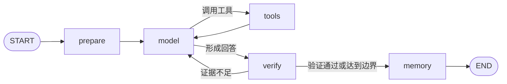

# InsightForge Agent 工作流

## 1. 工作流概览

核心分析流程定义在 `app/graph.py`，使用 LangGraph 管理状态和分支：

每个 Run 使用自己的 `run_id` 作为 LangGraph `thread_id`，状态保存在 PostgreSQL Checkpoint 中。Worker 重启后可以根据持久化状态继续处理可恢复任务。

## 2. Prepare：构建受控上下文

Context Builder 按 Token 预算组合：

- 当前问题和最近对话；
- Thread 摘要；
- 用户明确保存的展示或分析偏好；
- Northwind Schema 与业务指标；
- Hybrid RAG 召回的知识；
- NL2SQL 安全策略。

渲染后的 Prompt 和 Context 会分别保存快照，便于复盘同一次运行到底向模型提供了什么。

## 3. Model：模型决策

生产模式通过 DashScope 的 OpenAI-Compatible API 调用 Qwen，使用原生 Function Calling。模型每轮只能做两类决策：

1. 返回结构化工具调用；
2. 基于已有观察结果生成回答。

离线测试通过 Mock Gateway 生成确定性结果，不消耗外部 API 配额。

## 4. Tools：受治理的工具执行

Tool Registry 统一管理工具定义、参数 Schema、调用结果、耗时和异常。当前主要工具包括：

- 获取业务数据结构；
- 执行 Northwind 只读 SQL；
- 检索业务知识；
- 可选的 Tavily Web Search MCP。

SQL 执行前会经过 SQLGlot AST 校验，并由只读数据库账号执行。工具调用结果作为 Observation 返回 LangGraph，而不是直接成为最终回答。

## 5. Verify：证据校验与重新规划

Verifier 检查回答是否获得了足够的数据证据。如果证据不足且仍在治理边界内，流程返回 `model` 节点重新规划。以下条件会限制循环：

- Agent 最大循环次数；
- 最大工具调用次数；
- 最大运行时间；
- 单次 Token 预算；
- 重复工具调用和无进展检测。

因此，系统可能返回“带警告完成”，而不是无限重试。

## 6. Memory：记忆策略

- 短期记忆：Thread 消息、摘要和 LangGraph Checkpoint；
- 长期记忆：仅提取用户明确表达的展示或分析偏好；
- 用户可在设置页面查看和删除已保存偏好。

系统不应把模型推断出的敏感属性作为长期记忆保存。

## 7. 输出与可观测性

运行过程中，EventBus 将业务可理解的阶段事件同时写入持久化记录和 Redis Streams。前端通过 SSE 获取：

- 当前执行阶段；
- 最终文本回答；
- 指标卡、表格和图表；
- Token 用量、估算费用和耗时；
- 工具调用次数与验证状态。

系统保存工具调用、Prompt、Context 和运行指标，但不向前端暴露模型隐藏推理过程。

## 8. RAG 实现说明

当前 Hybrid RAG 包含两路召回：

1. PostgreSQL `pg_trgm` 文本相似度；
2. 确定性本地哈希向量与 pgvector 近邻查询。

两路排序通过 RRF 合并，结果缓存在 Redis。该实现成本低、可离线复现，但哈希向量不具备真实语义 Embedding 的表达能力。后续可保持检索接口不变，将向量生成器替换为 DashScope 或其他 Embedding 服务。

## 9. 调试阅读顺序

定位一次分析失败时，建议依次查看：

1. `app/api.py`：请求是否成功创建 Run；
2. `app/entrypoints/worker.py`：Worker 是否在线并消费队列；
3. `app/service.py`：运行状态和异常如何落库；
4. `app/graph.py`：失败发生在哪个节点；
5. `app/tools.py` 与 `app/northwind.py`：工具和 SQL 是否通过校验；
6. `app/runtime.py`：事件流和 Checkpoint 是否正常。
