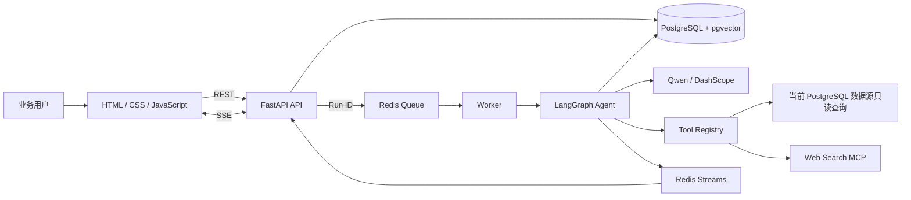

# InsightForge Agent 系统架构

## 1. 架构目标

InsightForge Agent 是一个面向业务人员的自然语言数据分析系统。当前版本采用单仓库、多容器架构，将 Web API、异步任务、Agent 编排、业务数据和运行状态分离，重点解决以下问题：

- 自然语言问题如何转换为可验证的业务查询；
- 长耗时分析如何异步执行并实时反馈进度；
- 模型生成的 SQL 如何限制为只读操作；
- Prompt、上下文、工具调用和运行结果如何留痕；
- 服务中断后如何依靠持久化状态恢复。

## 2. 运行组件

Docker Compose 启动七个服务：

| 服务 | 职责 | 对主机开放端口 |
|---|---|---|
| `postgres` | 系统数据、Northwind、RAG 索引和 Checkpoint | 无 |
| `redis` | 任务队列、事件流、Worker 心跳和 RAG 缓存 | 无 |
| `bootstrap` | 幂等初始化数据库、演示数据、索引和只读角色 | 无，一次性任务 |
| `worker` | 消费分析任务并执行 LangGraph | 无 |
| `api` | REST、SSE、静态页面和健康检查 | `127.0.0.1:6006` |
| `web-mcp` | 可选的 Tavily 联网搜索工具 | 仅容器网络 |
| `insightforge-mcp` | 向外提供分析、指标和数据源检查工具 | `127.0.0.1:8010` |

## 3. 核心模块

| 模块 | 主要职责 |
|---|---|
| `app/main.py` | 创建 FastAPI 应用并托管前端静态资源 |
| `app/api.py` | 对话、分析、SSE、看板、数据源、记忆和导出接口 |
| `app/service.py` | 连接 API、Redis 队列、Worker 与 Agent 的应用门面 |
| `app/graph.py` | 定义 LangGraph 状态和循环节点 |
| `app/context.py` | 组装会话、记忆、Schema、指标和检索结果 |
| `app/model.py` | Qwen Function Calling 与离线 Mock 模型适配 |
| `app/tools.py` | 注册本地工具和 MCP 工具，统一记录调用 |
| `app/northwind.py` | Northwind 业务视图、指标、SQL 校验与查询 |
| `app/rag.py` | `pg_trgm` 与本地哈希向量召回、RRF 融合、Redis 缓存 |
| `app/runtime.py` | PostgreSQL Checkpoint、Redis Streams 与运行事件 |
| `app/repository.py` | 系统业务表的数据访问层 |

## 4. 数据与状态

PostgreSQL 同时承担四类持久化职责：

1. 对话数据：Thread、Message、用户记忆；
2. 运行审计：Run、事件、工具调用、Prompt 和 Context 快照、反馈；
3. Agent 状态：LangGraph PostgreSQL Checkpoint；
4. 演示业务数据：`northwind` Schema、业务视图和 RAG 知识索引。

Redis 只保存可重建或短期运行数据，包括任务队列、事件流、Worker 心跳和检索缓存。PostgreSQL 是系统记录的最终来源。

应用表结构由 Alembic 迁移管理。已有 v0.1.0 数据库会先记录基线，再执行增量迁移；全新数据库从迁移脚本创建。

动态 PostgreSQL 数据源由独立服务层管理：外部密码使用认证加密保存，连接测试强制只读和超时，Schema 发现只读取允许的业务 Schema，API 永不返回密码或密文。

## 5. 一次请求的数据流

1. 前端创建或选择 Thread，向 API 提交分析问题。
2. API 创建 Message 和 Run，将 Run ID 写入 Redis 队列。
3. Worker 消费 Run ID，调用 `AnalysisService.execute_run()`。
4. LangGraph 的 `prepare` 节点构建上下文并保存快照。
5. `model` 节点让模型回答或生成结构化工具调用。
6. `tools` 节点执行 SQL 或 MCP 工具，并记录参数、结果和耗时。
7. `verify` 节点检查证据；证据不足时返回模型重新规划。
8. `memory` 节点提取用户明确表达的偏好。
9. 结果写入 PostgreSQL，事件通过 Redis Streams 和 SSE 返回页面。

## 6. 安全边界

- 业务 SQL 使用独立的 `northwind_reader` 数据库角色；
- SQLGlot 解析 SQL AST，只接受单条只读查询；
- API 只绑定到本机回环地址；
- 循环次数、工具次数、执行时间和 Token 均设上限；
- `.env` 不进入 Git 或 Docker 构建上下文；
- 当前系统没有登录、RBAC 和多租户隔离，因此定位为本地学习与演示环境，不应直接连接未授权生产数据库。

## 7. 当前边界与演进方向

- 保留 Northwind 内置数据源，并支持动态接入和切换 PostgreSQL 数据源；
- 向量召回使用确定性本地哈希向量，不等同于大模型 Embedding；
- 前端为原生 JavaScript 单页界面，没有独立构建流程；
- Docker Compose 适合本地部署，不是完整的生产编排方案；
- 后续重点是用户认证、RBAC、多用户数据隔离和真实向量检索。
