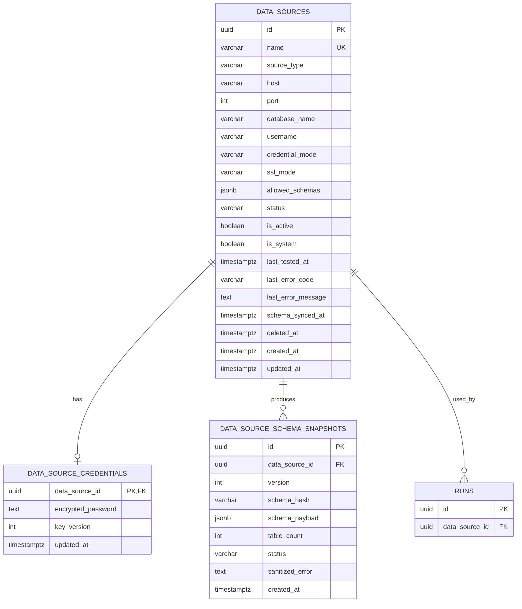

# 动态数据源数据模型设计

**状态**：已交付并通过外部数据库验收

**目标版本**：v0.2.0

**首期范围**：PostgreSQL 只读数据源

## 1. 目标与非目标

### 目标

- 允许用户新增、测试、启用、停用和查看 PostgreSQL 数据源；
- 自动发现允许访问的 Schema、表、字段、主外键和基础统计信息；
- 每次分析明确绑定一个数据源，历史记录可以追溯；
- 数据库密码加密保存，且不通过 API、日志或异常信息返回；
- 保持现有 Northwind、历史对话和分析记录兼容；
- 为后续 MySQL、SQL Server 等类型保留扩展边界。

### 首期不包含

- MySQL、SQL Server、Oracle 和文件数据源；
- 多用户登录、RBAC 和多租户；
- 跨数据源 JOIN；
- 自动写入或修改外部数据库；
- 从生产数据库采集大量样例数据；
- 公网生产部署能力。

## 2. 核心设计决定

### 2.1 控制库与业务库分离

InsightForge Agent 自己的 PostgreSQL 继续作为控制库，保存数据源配置、Schema 快照、对话和运行记录。用户接入的数据库只作为业务查询目标，不保存系统运行状态。

这样可以避免在外部数据库中创建 InsightForge 表，也能在业务数据源暂时离线时继续查看历史运行记录。

### 2.2 首期只支持 PostgreSQL

首期固定 `source_type=postgresql`。不同数据库的元数据发现、SQL 方言、连接参数和权限模型差异较大，先完成一个可靠的端到端实现，再通过适配器接口扩展其他类型。

### 2.3 不接受完整 DSN

API 分字段接收主机、端口、数据库、用户名、密码、SSL 模式和允许的 Schema。服务端根据白名单参数构造连接，不允许用户提交任意连接字符串或驱动参数。

### 2.4 Northwind 是系统数据源

现有 Northwind 在迁移时注册为 `is_system=true` 的默认数据源：

- 凭据继续来自环境变量；
- 不复制或重建现有业务数据；
- 不允许删除；
- 可以从其他数据源切回；
- 现有 Run 在回填完成前仍能按 Northwind 解释。

### 2.5 使用软删除

用户删除数据源时写入 `deleted_at`，不立即物理删除。已有 Run 始终保留数据源外键和显示名称，避免历史分析失去来源。

## 3. 实体关系



## 4. 表设计

### 4.1 `data_sources`

保存非秘密连接信息和运行状态。

| 字段 | 类型 | 约束与说明 |
|---|---|---|
| `id` | `VARCHAR(36)` | 主键，沿用当前 UUID 字符串风格 |
| `name` | `VARCHAR(120)` | 未删除记录中唯一，供用户识别 |
| `source_type` | `VARCHAR(30)` | 首期仅允许 `postgresql` |
| `host` | `VARCHAR(255)` | 不包含协议和密码 |
| `port` | `INTEGER` | PostgreSQL 默认 5432，范围 1–65535 |
| `database_name` | `VARCHAR(120)` | 目标数据库名 |
| `username` | `VARCHAR(120)` | 推荐专用只读用户 |
| `credential_mode` | `VARCHAR(30)` | `encrypted` 或 `environment` |
| `ssl_mode` | `VARCHAR(20)` | 白名单：`disable/prefer/require/verify-ca/verify-full` |
| `allowed_schemas` | `JSONB` | 非空字符串数组，默认 `public` |
| `status` | `VARCHAR(30)` | `untested/online/offline/disabled` |
| `is_active` | `BOOLEAN` | 当前全局数据源；同一时间最多一个 |
| `is_system` | `BOOLEAN` | Northwind 为 `true`，禁止删除 |
| `last_tested_at` | `TIMESTAMPTZ` | 最近一次连接测试时间 |
| `last_error_code` | `VARCHAR(60)` | 稳定错误码，不含密码和 DSN |
| `last_error_message` | `TEXT` | 清洗后的用户提示，限制长度 |
| `schema_synced_at` | `TIMESTAMPTZ` | 最近成功发现 Schema 的时间 |
| `deleted_at` | `TIMESTAMPTZ` | 软删除标记 |
| `created_at/updated_at` | `TIMESTAMPTZ` | 审计时间 |

建议索引和约束：

- 对 `lower(name)` 建立“未删除记录唯一”索引；
- 对 `is_active=true AND deleted_at IS NULL` 建立唯一部分索引；
- 检查端口范围、数据源类型、状态、SSL 模式和凭据模式；
- 系统数据源必须使用 `credential_mode=environment`。

### 4.2 `data_source_credentials`

秘密信息与普通配置分表，普通列表和详情查询不加载该表。

| 字段 | 类型 | 说明 |
|---|---|---|
| `data_source_id` | `VARCHAR(36)` | 主键兼外键 |
| `encrypted_password` | `TEXT` | 使用主密钥加密后的密文 |
| `key_version` | `INTEGER` | 为后续密钥轮换预留 |
| `updated_at` | `TIMESTAMPTZ` | 最近更新凭据时间 |

密码处理规则：

- 使用环境变量 `DATA_SOURCE_ENCRYPTION_KEY` 提供主密钥；
- 使用经过认证的加密方案，不自定义加密算法；
- 创建或更新接口只接受密码写入，响应永远不返回密码或密文；
- 日志、审计事件和异常统一经过敏感字段清洗；
- 密钥缺失时禁止创建加密凭据数据源，但 Northwind 环境变量模式仍可运行；
- 主密钥丢失后无法恢复外部数据源密码，只能重新录入。

具体加密库和密钥轮换流程在实施前单独确认，不在模型层自行实现密码学算法。

### 4.3 `data_source_schema_snapshots`

每次成功发现元数据后新增不可变快照，而不是覆盖旧记录。

`schema_payload` 建议结构：

```json
{
  "schemas": [
    {
      "name": "public",
      "tables": [
        {
          "name": "orders",
          "kind": "table",
          "estimated_rows": 830,
          "columns": [
            {"name": "order_id", "type": "integer", "nullable": false}
          ],
          "primary_key": ["order_id"],
          "foreign_keys": []
        }
      ]
    }
  ]
}
```

约束：

- `(data_source_id, version)` 唯一；
- `schema_hash` 用于判断结构是否变化；
- 默认不保存真实业务样例值；
- 失败记录只保存清洗后的错误，不保存密码、DSN 或驱动堆栈；
- Agent 默认使用最近一次成功快照，数据源短暂离线时仍可展示结构。

### 4.4 `runs.data_source_id`

为现有 `runs` 表增加可空外键：

- 新 Run 创建时必须由服务层写入当前激活数据源；
- 历史 Run 首次迁移时保持可空，随后单独回填 Northwind ID；
- 回填验证通过后再考虑增加非空约束；
- 删除数据源采用软删除，因此不级联删除 Run。

## 5. 状态转换

```text
创建配置 → untested
测试成功 → online
测试失败 → offline
用户停用 → disabled
重新测试成功 → online
软删除 → deleted_at 非空且 is_active=false
```

只有满足以下条件的数据源才能设为当前数据源：

- 未删除；
- 状态为 `online`；
- 至少包含一个允许的 Schema；
- 存在可用凭据；
- 最近一次 Schema 发现成功。

激活操作必须在一个数据库事务中完成：锁定当前激活记录，取消旧数据源，再激活目标数据源，防止同时出现两个活动数据源。

## 6. 连接与发现安全策略

### 6.1 连接测试

- 连接超时建议 5 秒；
- 设置只读会话和语句超时；
- 只执行 `SELECT 1`、版本读取和权限检查；
- 拒绝明显的管理员角色并提示使用专用只读账号；
- 错误映射为稳定错误码，例如 `AUTH_FAILED`、`HOST_UNREACHABLE`、`TLS_FAILED`、`READ_ONLY_REQUIRED`；
- API 不返回驱动原始异常。

### 6.2 Schema 发现

- 只扫描 `allowed_schemas`；
- 排除 `pg_catalog`、`information_schema` 和临时 Schema；
- 限制 Schema、表和字段总数；
- 行数使用 PostgreSQL 统计估算，避免逐表 `COUNT(*)`；
- 首期不采集业务样例值；
- 发现任务设置总超时，并允许用户重新同步。

### 6.3 查询执行

- 每个数据源使用独立连接池；
- 连接池设置较小上限和空闲回收；
- SQLGlot 按 PostgreSQL 方言解析；
- 仅允许单条 `SELECT` 或安全的 `WITH ... SELECT`；
- 设置只读事务、语句超时和最大返回行数；
- 禁止访问 `allowed_schemas` 之外的对象；
- Run 和 ToolCall 必须记录数据源 ID，但不记录密码。

## 7. Northwind 兼容方案

迁移后自动确保存在一条系统记录：

```text
name: Northwind 贸易数据
source_type: postgresql
credential_mode: environment
allowed_schemas: [northwind]
is_system: true
is_active: true（没有其他活动数据源时）
```

连接参数来自当前 `BUSINESS_DATABASE_URL` 或拆分后的环境变量。第一阶段不删除 `NorthwindSource`，而是让它实现统一数据源适配器接口，以降低回归风险。

现有 Redis 键、控制库表、Docker 数据卷和 Northwind Schema 名称保持不变。

## 8. 迁移计划

项目已使用 Alembic 管理数据库结构，动态数据源相关变更通过增量迁移交付，避免通过 ORM 模型隐式修改已有数据库。

### Migration 001：建立迁移基线

- 将当前已存在的系统表结构记录为 Alembic 基线；
- 对已有环境执行 stamp，不重复创建现有表；
- 对全新环境由迁移创建同样结构；
- 保留 Northwind 数据导入和 RAG 初始化在 bootstrap 中。

### Migration 002：扩展结构

- 创建 `data_sources`；
- 创建 `data_source_credentials`；
- 创建 `data_source_schema_snapshots`；
- 为 `runs` 添加可空 `data_source_id`；
- 创建检查约束、唯一部分索引和普通索引。

### Data Migration 003：注册 Northwind

- 幂等创建系统 Northwind 数据源；
- 将既有 Run 分批回填到 Northwind；
- 对记录数量和外键一致性进行验证。

### 后续收紧

只有在所有历史 Run 都完成回填且应用稳定后，才考虑将 `runs.data_source_id` 改为非空。删除字段或旧兼容代码必须放在更晚的独立版本中。

## 9. 回滚与故障恢复

- Schema 扩展阶段只增加表和可空字段，不修改现有列，旧应用仍可运行；
- 应用回滚到 v0.1.0 时，新表和新字段可以保留，不立即删除；
- Northwind 仍使用原有环境变量和 Schema；
- 数据回填失败时停止迁移，修复后继续，不删除历史 Run；
- 生产式回滚采用新的前向迁移，不修改已经执行的迁移文件；
- 开发前可通过 Git 标签 `v0.1.0` 回到当前稳定代码。

## 10. API 数据边界

虽然本文件重点是数据模型，但模型必须支持以下响应原则：

- 列表接口只返回非秘密字段和 `has_password`；
- 创建、更新接口中的 `password` 是只写字段；
- 更新时密码留空表示保持原密码，不表示清空；
- 错误响应返回稳定错误码和可读提示；
- 数据源删除、激活、同步 Schema 均产生审计事件；
- 主机和用户名是否脱敏可在实现 API 时再确定，但密码与密文始终不可返回。

## 11. 实施拆分

建议按以下提交拆分，任何一步失败都能独立回退：

1. 引入 Alembic 并建立现有结构基线；
2. 添加数据源模型、约束和迁移；
3. 添加凭据加密服务和脱敏测试；
4. 注册 Northwind 系统数据源并回填 Run；
5. 添加 PostgreSQL 连接测试和 Schema 发现；
6. 添加数据源 CRUD、激活和同步 API；
7. 将 Context、Tool Registry 和 Run 绑定到数据源；
8. 添加前端数据源管理；
9. 完成回归、部署、文档和 v0.2.0 发布。

## 12. 实施前验收条件

开始编码前需要确认：

- [x] 首期只支持 PostgreSQL；
- [x] 系统当前只有一个全局活动数据源；
- [x] Northwind 作为不可删除的系统数据源；
- [x] 外部密码使用主密钥加密，Northwind 凭据继续来自环境变量；
- [x] 默认不采集业务样例值；
- [x] 删除采用软删除；
- [x] 引入 Alembic 管理后续结构变化；
- [x] v0.1.0 标签作为实施前回退点。

## 13. 实施进度

已完成 Alembic 基线、三张数据源表、`runs.data_source_id` 外键、Northwind 注册、历史 Run 回填、Fernet 认证加密服务、PostgreSQL 只读连接测试、Schema 自动发现、后端 CRUD/API、前端管理页面和 Agent 动态接入。每次 Run 固定绑定创建时的活动数据源；Context 和查询工具按该绑定读取 Schema 与凭据，限制只读 SELECT、Schema 白名单和最多 200 行，并隔离 Northwind 专属指标及 RAG 知识。
